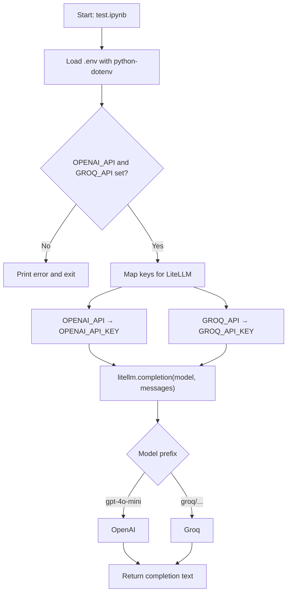
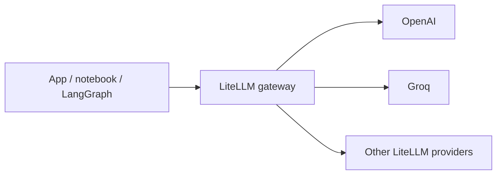

# LLM Gateways

Experiment with a unified LLM gateway using [LiteLLM](https://github.com/BerriAI/litellm), with [LangChain](https://python.langchain.com/) and [LangGraph](https://langchain-ai.github.io/langgraph/) available for agent workflows.

Call multiple providers (OpenAI, Groq, and others supported by LiteLLM) through one interface — useful for routing, fallbacks, and cost-aware model selection.

## Workflow

How the current smoke tests in `test.ipynb` reach a provider:



Intended gateway shape (LiteLLM as the single call surface; LangChain / LangGraph optional on top):



## Current status

Early setup and provider smoke tests:

- `main.py` — minimal entry point stub
- `test.ipynb` — loads API keys from `.env`, then runs sample `completion` calls against OpenAI (`gpt-4o-mini`) and Groq (`groq/qwen/qwen3.8-27b`) via LiteLLM

## Requirements

- Python `>=3.14` (see `.python-version`)
- [uv](https://docs.astral.sh/uv/) recommended for install / lockfile sync
- API keys for the providers you want to use

## Setup

```bash
# Create/sync the virtual environment from the lockfile
uv sync

# Or install from requirements.txt
pip install -r requirements.txt
```

### Environment variables

Copy your keys into a `.env` file in the project root (already gitignored):

```env
OPENAI_API=sk-...
GROQ_API=gsk_...
```

`test.ipynb` maps these to the names LiteLLM expects:

| `.env` variable | Set as |
| --------------- | ------ |
| `OPENAI_API`    | `OPENAI_API_KEY` |
| `GROQ_API`      | `GROQ_API_KEY` |

## Usage

### Notebook (provider checks)

```bash
uv run jupyter notebook test.ipynb
# or open test.ipynb in VS Code / Cursor with the project kernel
```

The notebook:

1. Loads `.env` with `python-dotenv`
2. Verifies OpenAI and Groq keys are present
3. Sends a short prompt to each provider through `litellm.completion`

### Entry point

```bash
uv run python main.py
```

## Dependencies

Declared in `pyproject.toml` / `requirements.txt`:

| Package         | Role                                      |
| --------------- | ----------------------------------------- |
| `litellm`       | Unified LLM API / routing gateway         |
| `langchain`     | LLM application building blocks           |
| `langgraph`     | Graph-based agent / workflow orchestration |
| `python-dotenv` | Load secrets from `.env`                  |
| `ipykernel`     | Jupyter kernel for `test.ipynb`           |

## Project layout

```
LLM_Gateways/
├── main.py            # Entry point stub
├── test.ipynb         # LiteLLM multi-provider smoke tests
├── pyproject.toml     # Project metadata & dependencies
├── requirements.txt   # Pip-friendly dependency list
├── uv.lock            # Locked dependency versions (uv)
├── .python-version    # 3.14
└── .env               # Local API keys (not committed)
```

## Next steps

Likely directions for this repo:

- LiteLLM `Router` for load balancing / fallbacks across models
- Cost tracking with LiteLLM’s cost helpers
- LangGraph workflows that call models through the gateway
